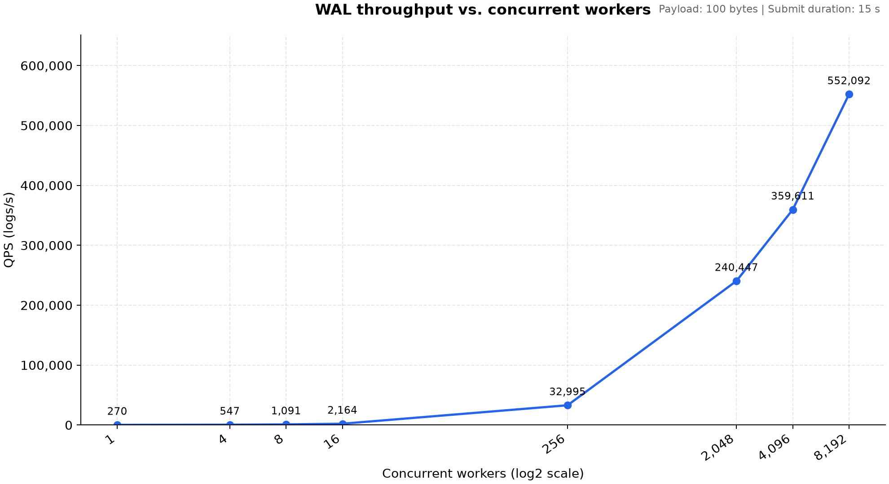
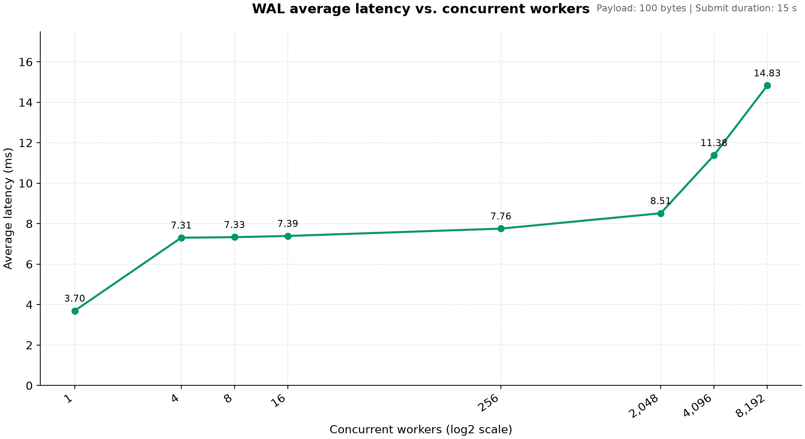
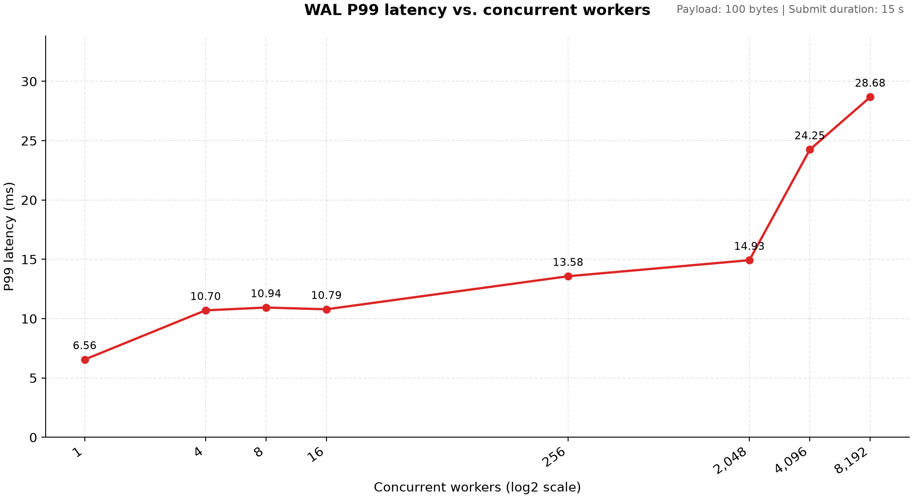

# simple wal

Go 语言实现的持久化追加 wal 库，支持恢复重放日志。仅适用于离线的恢复重放，不支持在线日志消费。


## 基本数据结构和接口

```go
package simplewal

// WAL
// WAL 实例
type WAL struct {
   
}

// Options
// 配置项
type Options struct {
}

// LSN
// log sequence number, 日志的单调递增序号
type LSN uint64

// Open
// 根据提供的目录，返回一个 WAL 实例
// Options 用于控制 WAL 实例的行为参数
func Open(dir string, opt Options) (*WAL, error)

// Append
// 提交日志接口，成功时返回 lsn && err == nil。成功返回表示日志已经持久化。
// 可以并发调用。
func (w *WAL) Append(payload []byte) (LSN, error) 

// Replay
// 读取持久化的日志文件，读取时会做数据校验，回放 LSN >= start 的日志。start 不存在或者超过当前 WAL 最大 LSN 时，返回 error。
// 同一个 WAL 实例调用 Replay 时，不支持并发调用其他接口
func (w *WAL) Replay(start LSN, action func(LSN, []byte) error) error 

// Trim
// Trim 已经不再需要的 wal 日志。尽力删除 LSN < before 的日志，WAL 不支持 Trim 时会返回 error。
// 同一个 WAL 实例调用 Trim 时，不支持并发调用其他接口。
func (w *WAL) Trim(before LSN) error

// Fix
// Fix 修复尾部损坏的日志文件
func (w *WAL) Fix() error

// Close
// 关闭 WAL 示例，关闭前会把已经提交的 payload 全部持久化，调用该方法后不再接收新的 Append。
func (w *WAL) Close() error
```

## 能力边界
1. **支持平台**：支持 Linux 本地文件系统。对其他操作系统、网络文件系统没有测试，不保证正确性。

2. **Append 接口语义**：提交日志只有 Append 一个接口，没有类似 BatchAppend 的原子提交多条日志接口。SimpleWAL 把 payload 视为字节流，payload 的语义、具体表示一条日志还是多条日志由调用方决定。

3. **Append 接口原子性、幂等性**：Append 返回成功时（lsn >= 0 && err == nil)，表示提交的 payload 已经持久化。接口未返回时，不保证日志是否持久化。接口未返回或返回错误时，不保证可以幂等重试，重试的幂等需要调用方维护。

4. **并发 Append 的顺序**：持久化后的日志顺序由 Append 接口返回的 lsn 唯一确定。持久化的顺序和调用方的提交顺序无关、和 Append 接口的返回顺序无关。

5. **仅支持离线日志回放**：用于 Append 的 WAL 实例不支持 Replay Trim Fix 等离线接口；用于离线接口的 WAL 实例同样不支持 Append。Append 和离线操作之间需要先关闭、再重新打开 WAL 实例。

## 使用示例

```go
import (
	simplewal "github.com/dynamicers/simple-wal"
)

func main() {
  dir := "/path/to/wal"

  opt := simplewal.DefaultOptions()
  opt.CreateIfMissing = true
  opt.UsedForAppend = true

  w, err := simplewal.Open(dir, opt)
  if err != nil {
   	return err
  }
  defer w.Close()

  for i in range(32) {
    var payload = make([]byte, 100)
    go func() {
      var lsn, err = wal.Append(payload)
      if err != nil {
        return err
      }
    }
  }
}
```

## 架构设计

### 1. 总体分层

simplewal 库的架构从调用方到底层总体分为如下几层：

- **调用方**

- **WAL 接口层**：wal.go 实现。定义 wal 对外接口，负责 wal 的参数校验、状态管理、接口逻辑实现

- **WAL 队列提交层**：wal.go writer.go 中实现。实现 append 请求的入队、单 writer 的批量 write + sync、批量通知

- **存储接口层**：storage.go 中实现。规定统一的存储层接口，方便底层进行多种实现

- **存储实现层**：file_storage.go 中实现。实现存储层接口、多文件的轮转、Replay、Trim 逻辑

- **文件格式层**：file.og 中实现。规定单文件的格式、命名规则，实现常用辅助函数

- **日志格式层**：record.go 中实现。规定单条日志的格式，实现单条日志的常用辅助函数

### 2. WAL 接口层

WAL 接口层维护 WAL 的全局锁和各接口逻辑，各接口逻辑主要如下：

Open：
打开并锁定目录 -> 校验文件头
               -> 校验日志完整 -> 返回可追加的 WAL 实例用于日志写入
             ( -> 返回只读的 WAL 实例用于日志回放 )

Append：
并发 Append -> 有界队列
            -> 单 writer 组提交
            -> 存储层完整写入并同步
            -> 返回成功及逻辑 LSN

Replay：
提交回放请求 -> 确定回放的回调函数、回放的起始位置
             -> 顺序读取日志
             -> 校验日志完整
             -> 调用回放回调

Trim：
提交修剪请求 -> 确定修剪的位置
             -> WAL 实例执行修剪

Fix：
提交修复请求 -> 到日志尾部检查最后的日志记录是否不完整
             -> WAL 实例 truncate 最后的不完整日志

### 3. WAL 队列提交层

WAL 按批组织 Append 提交的日志，单个批次有大小限制，由参数控制；单批次大小达到阈值后，创建新批次。

不会额外等待 Append 请求来凑一个更大的批次，等待的事件实际就是 write + sync 阻塞的时间。

使用单个 writer 来负责 wirte + sync 批次，每次按整批来编码、写入。

WAL 全局锁来保护队列头尾状态、LSN 的分配。

每个批次使用一个 channel 来接收 Sync 完成的通知，writer 在 Sync 结束后关闭当前批次的 channel 来通知当前批次涉及的 Append 已经完成

### 4. 存储实现层

存储实现层同时支持单日志文件、多日志文件，依靠单文件大小的配置决定。

单文件大小配置为 0 时，表示不对文件大小做限制，实际就是单日志文件；为正数时，会在超过文件阈值时(不是严格限制)，新建日志文件来轮转。

在切换写入文件时，不会拆分批次，单个批次只会全部在一个文件中。

新文件的创建顺序：
- 创建同目录临时文件
- 写完整文件头
- Sync 文件
- 重命名为正式文件
- Sync 目录
- 开始写入日志记录

文件名使用当前日志文件第一条日志的 LSN，例如：
 ```text
   00000000000000000000.wal  // 第一个日志文件，文件内首条日志 LSN 是 0
   00000000000000008192.wal // 第二个日志文件，文件内首条日志 LSN 是 8192
 ```


### 5. 文件和日志格式层

文件格式固定为文件头 + 日志条目。

文件头格式固定，大小为 20 bytes，当前为 hardcode。

文件头一共三个字段：
```text
file magic + version : 8 字节，内容 hardcode
firstLSN ： 8字节，记录文件内首条日志的 LSN (在创建日志文件时就能确定了)
文件头 crc32： 4 字节，前两个字段的 crc32
```

每条日志记录的格式固定，header + payload。

日志记录的 header 大小固定为 16 字节，整个日志记录格式如下：
```text
LSN：8字节， 当前日志记录的 lsn
length：4字节，当前日志记录 payload 的字节数
crc32: 4字节，前两个字段 + payload的 crc32
payload：不定长，调用方写入的日志条目
```

## 测试及 benchmark

## 黑盒测试/正确性测试

```bash
go test
```

### benchmark

两种方式：

1. 使用 go test 

```bash
WAL_BENCH_DIR=~/wal/bench go test -run '^$' -bench=. -benchmem -benchtime=10s -count=3 -timeout=10m .
```

2. 使用独立的测试程序

```bash
go build -o walbench ./cmd/walbench

./walbench -dir ~/wal/bench -workers 128 -duration 30s -size 100

for c in 1 4 16 64 128 256; do
  ./walbench -dir ~/wal/bench -workers "$c" -duration 30s -size 100
done
```

3. walbench 测试结果参考

目前手头没有 HDD 环境，暂时只测试了 SSD 的数据

测试环境：

```text
OS:   Linux 6.12.107+deb13-amd64
CPU:  Intel(R) Core(TM) i5-8300H (8) @ 4.00 GHz
nvme: SAMSUNG MZVLB512HAJQ-000L2
```

测试命令：

使用 100 bytes 负载，逐步增加 worker 数据，增大提交并发：

```text
for c in 1 4 8 16 256 2048 4096 8192; do ./walbench -dir ~/wal/bench -workers "$c" -duration 15s -size 100; done > walbench_result.txt
```

测试结果：

[测试结果](./cmd/walbench/test/walbench_result.txt)





## 开发流程及 Milestone

1. **确定接口**：方案调研、确定接口和总体设计方案

2. **实现原型**：实现各层接口、单日志文件串行提交的简单原型

3. **黑盒测试**：补齐黑盒测试，保证正确性，方便后续迭代

4. **benchmark**：补齐 benchmark

5. **实现组提交**：实现组提交，提高并发 append 性能

6. **实现多文件轮转**：支持底层多日志文件，支持文件 Trim

7. **补齐离线接口**：补齐错误修复接口(Fix 接口)，具备基础的错误修复能力

8. **后续 TODO**：

  - 增加性能打点，方便定位性能瓶颈

  - 优化接口使用体验，离线 Trim 等操作不必重新打开 wal 实例

  - 完善 Fix 接口，尽可能提供更多修复能力

  - 优化 Replay 性能，避免全文件扫描

